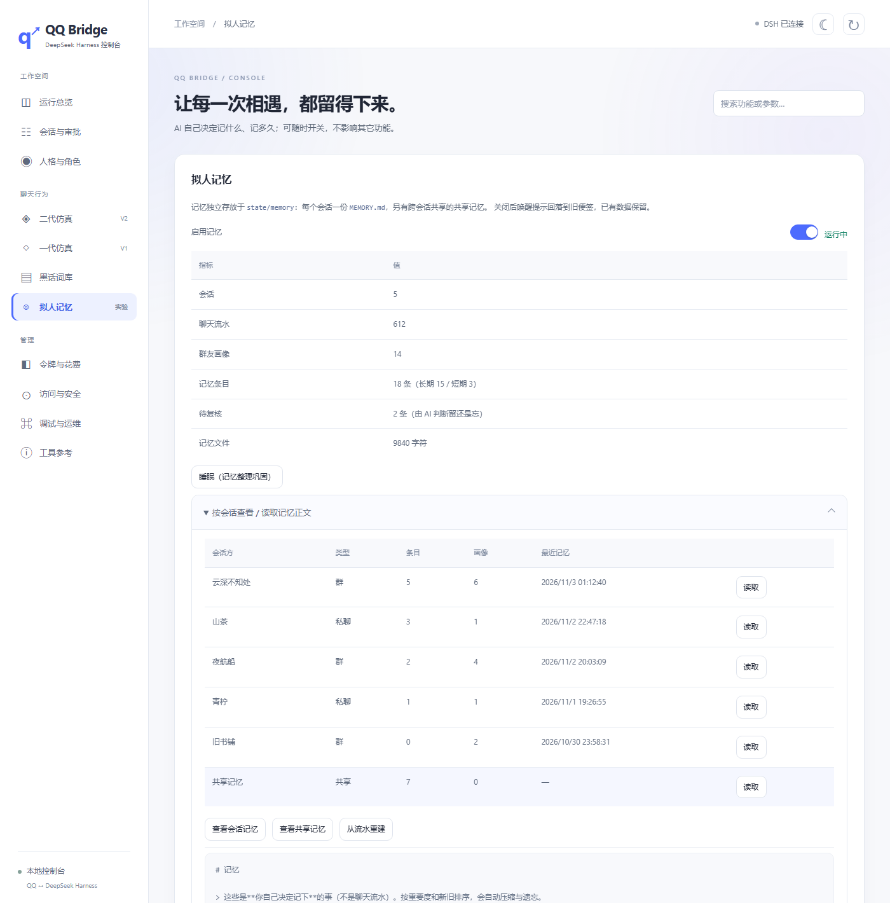

# 拟人记忆

> 小鲸鱼有自己的长期/短期记忆。**记不记、记多久、要不要忘、怎么合并，全由它自己判断**——
> 代码只负责存取和"提醒它该复核了"，不替它做任何语义决定。



---

## 1. 核心思路：AI 自己管记忆

与「把记忆塞进提示词」的区别：

| | 旧做法（上下文注入） | 现在（拟人记忆） |
| --- | --- | --- |
| 唤醒时 | 把记忆正文按字符预算拼进 prompt | 只给一份**索引**：有多少条、最近记了什么 |
| 回忆 | 被动接收，无法"想起来" | 主动调 `qq_memory_recall` 查 |
| 记忆内容 | 规则按显著度自动记 | AI 判断"这值不值得记"再写 |
| 遗忘 | 规则按 ★ 和天数删 | 规则只标记「待复核」，AI 决定去留 |
| 整理 | 规则自动合并/压缩 | 点「睡眠」主动调模型巩固 |

唤醒提示里给它的索引大致是：

```
【你的记忆】两层：共享记忆（跨群/私聊共享）+ 本会话记忆（只在这里有效）。
- 本会话 6 条（长期 6/短期 0），共享 4 条，流水 394 条 / 12 人 / 5 天。
【记不记由你判断】值得记就自己写：qq_memory_save(key, text, scope, importance, who, layer)
  · layer=global → 共享记忆；layer=session（默认）→ 只在本会话有效。
  · scope=long 约定/偏好/重要经历；scope=short 一时话题（3 天后进复核队列）。
  · 不写也不丢细节（流水仍在、recall 查得到），但只有写下的才算"记得"。
【牵扯到过去就先查】先 qq_memory_recall(key, question)，再开口。
```

## 2. 两层记忆

| 层 | 放什么 | 谁能查 |
| --- | --- | --- |
| **共享记忆**（`layer="global"`） | 关于某个人/某件事**本身**的事实：山茶在准备插画集投稿、阿灯不吃香菜、老周是开书店的 | **任何会话**都查得到（A 群写的，B 群也认） |
| **本会话记忆**（`layer="session"`，默认） | 只属于这个群/私聊的事：本群周五团建、这轮话题聊到一半 | 只有本会话 |

- 存储分开：`state/memory/_global/`（共享层）+ `state/memory/<会话>/`（各会话）。
- 检索时两层一起查，命中标注 `[共享]` / `[本会话]`；共享层排前面。
- **隐私边界**：A 群的具体聊天内容不会出现在 B 群；只有明确写成 `layer="global"` 才跨会话共享。
- 会话层与共享层各自从 `m1` 编号，所以对外用带层前缀的 `ref`（`session:m1` / `shared:m1`）区分。

## 3. 记什么、怎么合并：先读后写

写之前先看已有条目，避免重复：

1. `qq_memory_candidates(key, who?, layer?)` —— 看候选（id / 文本 / ★ / 层）
2. 如果其中已有同一件事：`qq_memory_save(..., replaceId=那条的 id, text=合并后的完整版本)`
3. 否则正常新增

服务端只做一件事机械保护：**归一化后完全相同**的内容不重复新增（防工具重试）。

## 4. 遗忘：规则只提醒，判断交给 AI

| 触发 | 规则动作 |
| --- | --- |
| 短期记忆满 3 天 | 标记 `needsReview`，进复核队列 |
| 长期记忆 90 天没被想起 | 标记 `needsReview`，进复核队列 |
| 超过单会话容量（默认 400） | 把最不重要且最旧的若干条标记 `needsReview`（**不删**） |
| 已遗忘条目超过 7 天 | 物理删除（可追溯期结束，存储清理） |

**AI 用 `qq_memory_review` 处理队列**：

| action | 含义 |
| --- | --- |
| `keep` | 保留并重新计时（之后不再催） |
| `forget` | 遗忘 |
| `compress` | 压缩到指定字数 |
| `promote` | 短期升为长期 |
| `update` | 改写内容（也用于合并多条） |

关键原则（写进提示词）：**不要因为"旧"就删事实**——某人的身份、长期喜好不会过期；
该忘的是过时的话题和已失效的约定。这是纯规则做不到的判断。

被 `qq_memory_recall` 命中会刷新 `lastAccess`——常被想起的事不会进队列。

## 5. 睡眠：记忆整理巩固

控制台点「睡眠（记忆整理巩固）」→ `POST /api/memory/sleep`：

```
遍历有记忆的会话
  → 向 DSH agent 投递一条静默整理指令（silent，不发 QQ 消息）
  → 模型自己：
     · qq_memory_review 看待复核队列，逐条 keep/forget/compress/update
     · qq_memory_candidates 检查共享记忆的重复与矛盾，用 replaceId 合并成一条
     · 顺手补记这段时间值得长期记住的事
```

**代码侧不做任何整理判断**：没有自动合并、没有自动压缩、没有自动删除。
每小时自动检查一次（有到期条目才触发，20 小时内最多一次）。

## 6. 存储

```
state/memory/<会话 key 冒号转横线>/
  MEMORY.md         可读正文（按天分节、最新在上、★ 表示重要度、⏳ 表示待复核）
  memories.json     AI 自己写的记忆（scope/importance/lastAccess/status/needsReview）
  events-*.jsonl    聊天流水（供 recall 查细节与审计）
  profiles.json     群友画像   index.json 锚点索引   meta.json 水位
state/memory/_global/   共享记忆（同样的结构）
state/names.json        群名/好友昵称缓存（6 小时过期）
```

`MEMORY.md` 可以直接用编辑器打开查看、修正；改坏了在控制台点「从流水重建」还原。

## 7. 控制台

「聊天行为 → 拟人记忆」：

- **启用记忆**（开关，写 `config.json` 即时生效）
- 统计：会话 / 聊天流水 / 群友画像 / 记忆条目 / 待复核 / 记忆文件大小
- **睡眠（记忆整理巩固）** —— 主动调模型整理
- **按会话查看**：显示**群名 / 好友昵称**（不是 `group:123`）、类型、条目数、画像数
- 按钮：查看会话记忆 / 查看共享记忆 / 从流水重建 / 清空全部记忆

| 接口 | 用途 |
| --- | --- |
| GET `/api/memory` | 开关、统计、按会话明细（含 displayName/kind） |
| GET `/api/memory/file?key=` | 读 MEMORY.md（`key=_global` 读共享层） |
| POST `/api/memory/sleep` | 触发睡眠整理（`{}` 全部有记忆的会话，`{key}` 单个） |
| POST `/api/memory/retention` | 只标记到期条目（兼容旧路径，不整理） |
| POST `/api/memory/rebuild` | 从事件流重建 MEMORY.md |
| POST `/api/memory/enabled` | 开关 |
| POST `/api/memory/reset` | 清空 |

模型侧（会话令牌鉴权）：`memory-save` / `memory-recall` / `memory-candidates` /
`memory-review` / `memory-forget`。

## 8. 配置

```json
{
  "memory": {
    "enabled": true,
    "dir": "state/memory",
    "eventThreshold": 0.45,
    "recentDays": 7,
    "retention": {
      "shortTermDays": 3,
      "longStaleDays": 90,
      "capacityPerSession": 400,
      "forgottenGraceDays": 7
    }
  }
}
```

`retention` 只控制**什么时候提醒 AI 复核**，不控制删除——删除永远是 AI 的决定。

## 9. 运维

```bash
npm run test:memory                        # 31 项：检索、写入合并、复核队列、Markdown、控制台
node scripts/migrate-memory-markdown.mjs   # 把聊天流水重建成可读 MEMORY.md
node scripts/probe-memory-limits.mjs <key> # 看某会话的检索效果
```

- 觉得它记太碎：调高 `eventThreshold`，或在提示词里强调"只记以后会用到的"。
- 觉得它忘太快：调大 `retention.shortTermDays` / `longStaleDays`。
- 想让它重新认识某个群：控制台清空该会话记忆。
- 群名/昵称没刷新：删 `state/names.json` 后重启。

## 10. 如何移除

1. 控制台关掉开关；
2. 删 `src/memory/`、`src/name-resolver.js`、`scripts/*memory*`；
3. 删 `bridge.js` 里 `createMemoryPlugin` / `createNameResolver` 的接入、
   `/api/memory*`、`/api/socialV2/memory-*` 路由、`buildSleepPromptV2`，
   `public/console.html` 的拟人记忆页，`config.json` 的 `memory` 段。

桥接对记忆的依赖只有几处 `memoryPlugin?.` 软调用，删掉后其余功能不受影响。


